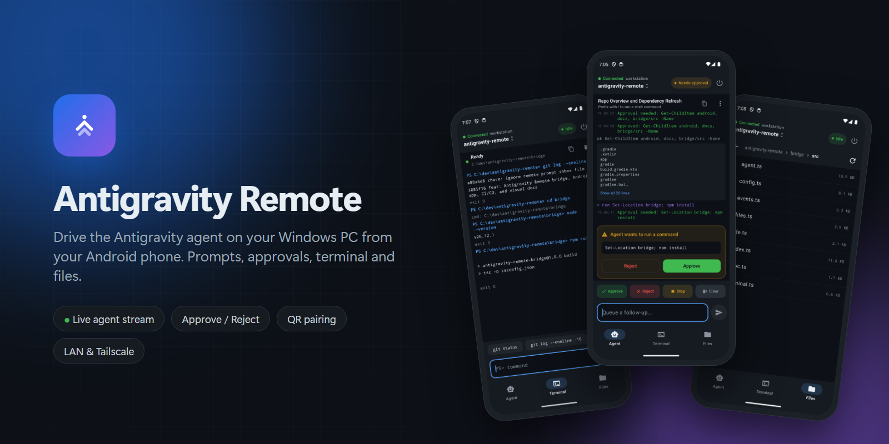
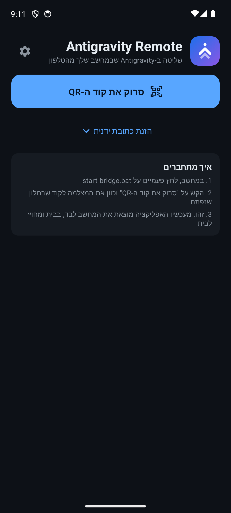
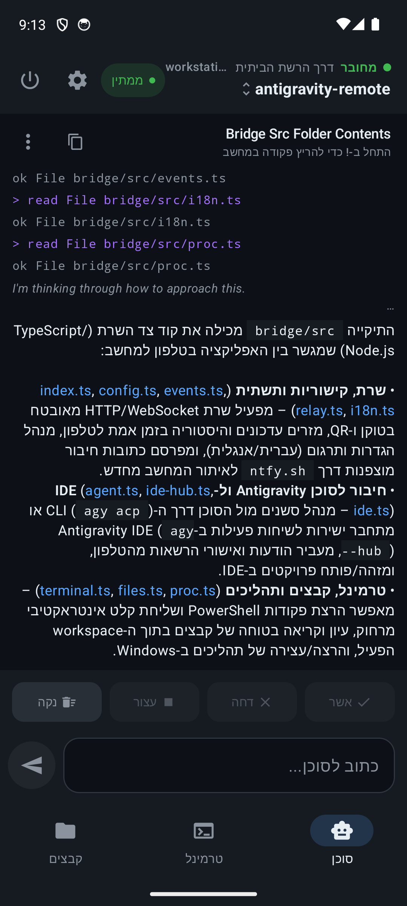
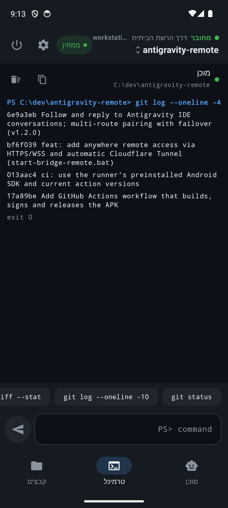
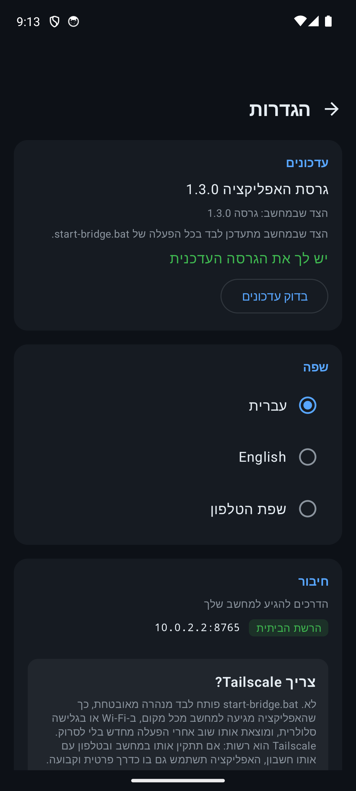

<div dir="rtl">

<p align="center">
  
</p>

<p align="center"><b>עברית</b> | <a href="README.md">English</a></p>

<p align="center">
  <a href="https://github.com/dor2500/antigravity-remote/releases/latest">
    
  </a>
</p>

# Antigravity Remote

**Antigravity IDE בטלפון שלך.** עוקבים אחרי שיחות הסוכן של ה-IDE בזמן אמת ועונים להן, פותחים שיחות חדשות, מאשרים או דוחים פקודות שהסוכן רוצה להריץ, משתמשים בטרמינל בתיקיית הפרויקט ומעיינים בקוד. עובד בבית ומחוץ לבית, ב-Wi-Fi ובגלישה סלולרית.

| התחברות | סוכן | טרמינל | הגדרות |
| :---: | :---: | :---: | :---: |
|  |  |  |  |

## התחלה בשלושה צעדים

1. **במחשב (Windows):** מורידים את הפרויקט ולוחצים פעמיים על `start-bridge.bat`. הוא מתעדכן לבד מ-GitHub, מתקין את מה שצריך, פותח מנהרה מאובטחת לגישה מכל מקום ומציג קוד QR. משאירים את החלון פתוח.

   ```powershell
   git clone https://github.com/dor2500/antigravity-remote; .\antigravity-remote\start-bridge.bat
   ```

2. **בטלפון (Android 8 ומעלה):** מורידים את [`AntigravityRemote-latest.apk`](https://github.com/dor2500/antigravity-remote/releases/latest/download/AntigravityRemote-latest.apk) ומתקינים. אם Android שואל, מאשרים התקנה מהדפדפן.

3. **סורקים את קוד ה-QR** שבחלון שבמחשב. זהו. מעכשיו האפליקציה מתחברת לבד, בבית ומחוץ לבית, גם אחרי שהמחשב הופעל מחדש.

לפני כן צריך ש-[Antigravity](https://antigravity.google) יהיה מותקן במחשב, ולהריץ פעם אחת `agy` בטרמינל כדי להתחבר לחשבון.

## צריך Tailscale?

**לא.** הגישה מכל מקום עובדת בלי שום הגדרה:

- `start-bridge.bat` פותח לבד מנהרה מאובטחת (HTTPS) דרך Cloudflare, בלי חשבון ובלי לשנות שום דבר בראוטר.
- הכתובת של המנהרה משתנה בכל הפעלה, אבל לא צריך לסרוק שוב. המחשב מפרסם את הכתובות העדכניות שלו בממסר (ntfy.sh) בצורה מוצפנת, עם מפתח שנגזר מקוד ההתאמה, והאפליקציה מוצאת אותן לבד.
- בבית האפליקציה מתחברת ישירות דרך הרשת הביתית, וכשיוצאים היא עוברת לבד למנהרה.

Tailscale הוא **רשות בלבד**. אם תתקין אותו במחשב ובטלפון עם אותו חשבון ותסרוק פעם אחת, האפליקציה תשתמש גם בו כדרך פרטית וקבועה שלא יוצאת מהרשת הפרטית שלך.

## מה יש באפליקציה

- **סוכן:** כותבים לסוכן של Antigravity ורואים בזמן אמת את התשובות, את הפקודות שהוא מריץ ואת הפלט. כשהסוכן מבקש אישור, מופיע כרטיס עם **אשר** ו**דחה**. **עצור** עוצר את מה שרץ.
- **שיחות IDE:** בתפריט של לשונית הסוכן בוחרים שיחה מ-Antigravity IDE, רואים את כל ההיסטוריה שלה וממשיכים אותה מהטלפון, בדיוק כאילו הקלדת ב-IDE.
- **טרמינל:** PowerShell בתיקיית הפרויקט. אפשר גם לענות לפקודה שמחכה לקלט.
- **קבצים:** עיון בתיקיות וקריאת קבצים, עם מספרי שורות.
- **פרויקטים:** החלפת הפרויקט מהטלפון, ופתיחה שלו ב-IDE במחשב.
- **עברית ואנגלית:** האפליקציה נפתחת בעברית, ואפשר להחליף שפה בהגדרות. קוד, פקודות ונתיבים נשארים משמאל לימין.

## עדכונים

- **האפליקציה:** **הגדרות > בדוק עדכונים**. האפליקציה בודקת ב-GitHub, מורידה את הגרסה החדשה, מוודאת שהקובץ תקין (SHA-256) ופותחת את מתקין Android. בפעם הראשונה Android יבקש לאשר לאפליקציה להתקין עדכונים.
- **הצד שבמחשב:** מתעדכן לבד בכל הפעלה של `start-bridge.bat`.

## אבטחה

- קוד ההתאמה (הטוקן) נותן שליטה מלאה בסוכן ובטרמינל במחשב. שמור עליו כמו על סיסמה.
- כתובת שמנחשת טוקן שגוי 10 פעמים נחסמת ל-10 דקות.
- המנהרה מוצפנת (HTTPS). הממסר מקבל רק מידע מוצפן.
- כדי לנתק את כל הטלפונים: `start-bridge.bat -ResetToken`, ואז סורקים מחדש.

## בעיות נפוצות

| מה קורה | מה עושים |
| --- | --- |
| האפליקציה לא מגיעה למחשב | ודא שחלון `start-bridge.bat` פתוח במחשב ושיש למחשב אינטרנט. |
| עובד מחוץ לבית אבל לא בבית | הפעל שוב את `start-bridge.bat` ואשר את בקשת ההרשאה (UAC) כדי לפתוח את הפורט לרשת הביתית. ברשתות אורחים זה חסום, אבל המנהרה עדיין עובדת. |
| "ה-CLI של Antigravity (agy) לא נמצא" | התקן את Antigravity, הרץ `agy` פעם אחת בטרמינל, והפעל שוב את `start-bridge.bat`. |
| "שיחות IDE (ה-IDE לא פתוח)" | פתח את Antigravity IDE במחשב. |

לפרטים טכניים, אפשרויות מתקדמות וממשק ה-API, ראה את [ה-README באנגלית](README.md).

</div>
