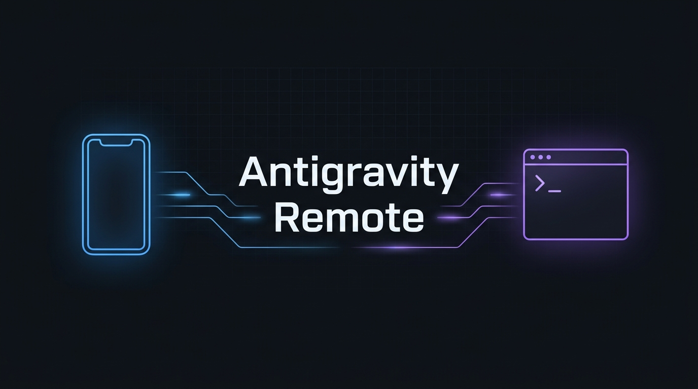
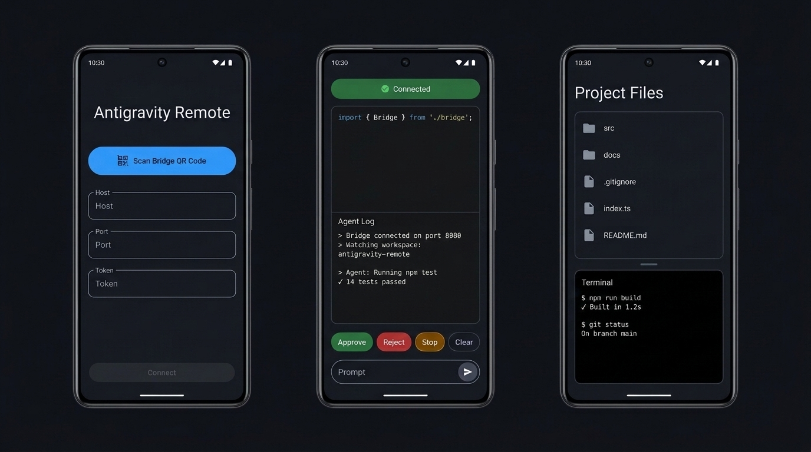
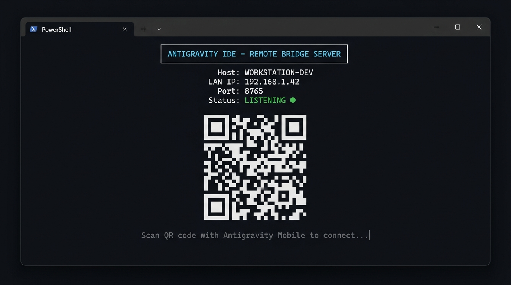
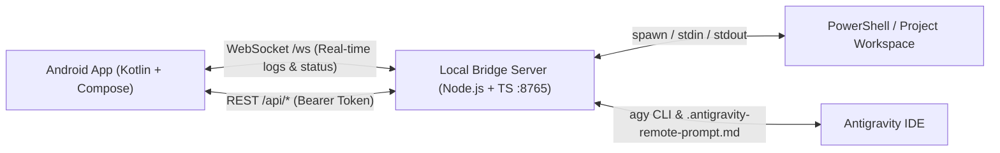

<p align="center">
  
</p>

<h1 align="center">Antigravity Remote</h1>

<p align="center">
  <strong>Low-latency remote control for Antigravity IDE on Windows — from any Android phone.</strong>
</p>

<p align="center">
  <a href="https://github.com/dor2500/antigravity-remote/actions/workflows/build-apk.yml">
    
  </a>
  <a href="https://github.com/dor2500/antigravity-remote/releases/tag/latest">
    
  </a>
  
  
</p>

---

## Download Android APK

Install directly on your Android device (Android 8.0+ / API 26+) from the latest automated GitHub Release:

> **[Download antigravity-remote.apk (Latest Release)](https://github.com/dor2500/antigravity-remote/releases/download/latest/antigravity-remote.apk)**

---

## Mobile App Preview

<p align="center">
  
</p>

- **Zero-Friction Pairing:** Built-in CameraX + ML Kit QR scanner connects in one tap, with manual IP / Port / Token fallback and saved profile auto-reconnect.
- **Control Tab:** Live auto-scrolling monospace output stream, one-tap copy, quick action bar (`Approve`, `Reject`, `Stop`, `Clear`), and multi-line prompt input.
- **Terminal Tab:** Interactive PowerShell execution in the active workspace with quick command chips (`git status`, `ls`, `pwd`, `npm test`).
- **Files Tab:** Browse project directories and inspect source files with a built-in syntax-friendly monospace viewer.
- **Workspace Switcher:** Tap the active workspace name in the top status bar to switch between projects on your PC.

---

## Zero-Friction QR Pairing (Windows Bridge)

<p align="center">
  
</p>

When you launch `bridge\start-bridge.bat`, the bridge automatically:
1. Installs dependencies and builds the TypeScript server.
2. Opens Windows Firewall TCP port `8765` (Private/Domain profile).
3. Detects your PC's LAN IPv4 address and generates a persistent 48-character Bearer token in `.bridge-config.json`.
4. Prints a scannable QR code in the terminal containing `{"ip": "...", "port": 8765, "token": "..."}`.

---

## Architecture



---

## Quick Start

### 1. Start the Local Bridge (Windows)
Double-click `bridge\start-bridge.bat` or run in PowerShell:
```powershell
.\bridge\start-bridge.ps1
```

### 2. Connect from Android
1. Install **[antigravity-remote.apk](https://github.com/dor2500/antigravity-remote/releases/download/latest/antigravity-remote.apk)** on your phone.
2. Ensure your phone is on the same Wi-Fi/LAN (or connected via **Tailscale / VPN**).
3. Tap **Scan Bridge QR Code** and point your camera at the bridge terminal.

> **Using Tailscale / VPN?** Enter your PC's Tailscale IP or MagicDNS hostname, port `8765`, and the token printed in the bridge terminal in the manual connection form.

---

## Bridge REST & WebSocket API

All `/api/*` endpoints require `Authorization: Bearer <token>`.

| Method | Endpoint | Description |
| :--- | :--- | :--- |
| `GET` | `/health` | Public health check |
| `GET` | `/api/status` | Hostname, LAN IP, active workspace, running state |
| `GET` | `/api/workspaces` | List discovered/configured workspaces |
| `POST` | `/api/workspaces/switch` | Switch active workspace (`{"path": "..."}`) |
| `POST` | `/api/prompt` | Send instruction/prompt (`{"prompt": "..."}`) |
| `POST` | `/api/terminal` | Run shell command in workspace (`{"command": "..."}`) |
| `POST` | `/api/action` | Trigger `approve`, `reject`, `stop`, `restart`, or `clear` |
| `GET` | `/api/files?path=` | List directory contents in active workspace |
| `GET` | `/api/files/read?path=` | Read file content (up to 256 KB) |
| `WS` | `/ws?token=<token>` | Bidirectional real-time log, status, and command stream |

---

## Building Locally

### Build the Android APK (Windows)
Requires JDK 17 and Android SDK (`C:\Android\Sdk` or `ANDROID_HOME`):
```powershell
.\build-apk.ps1
```
Output: `dist\antigravity-remote.apk`

### Automated CI/CD
Every push to `main` triggers [`.github/workflows/build-apk.yml`](.github/workflows/build-apk.yml), which compiles `app-debug.apk`, uploads it as a Workflow Artifact, and publishes `antigravity-remote.apk` to the `latest` GitHub Release.
