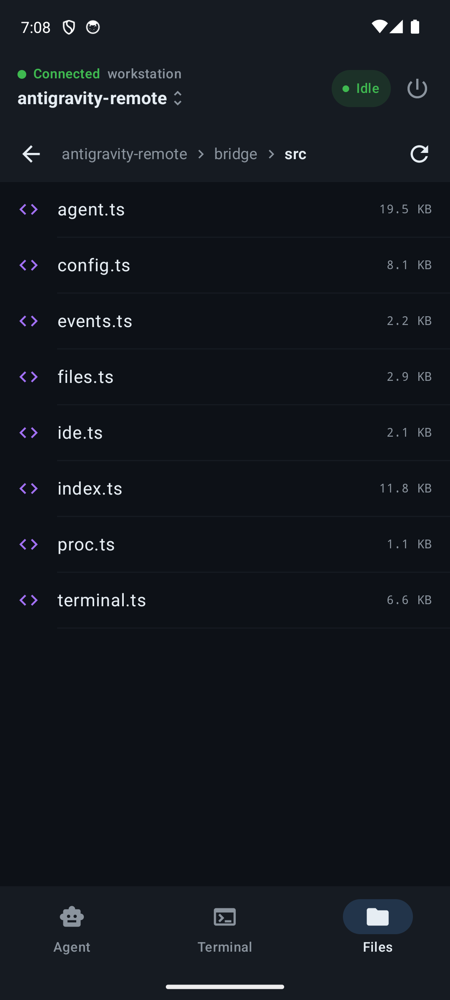

<p align="center">
  
</p>

<p align="center">
  <a href="https://github.com/dor2500/antigravity-remote/releases/latest"></a>
  <a href="https://github.com/dor2500/antigravity-remote/actions/workflows/build-apk.yml"></a>
  
  <a href="LICENSE"></a>
</p>

<p align="center">
  <a href="https://github.com/dor2500/antigravity-remote/releases/latest">
    
  </a>
</p>

**Antigravity Remote** lets you drive the Antigravity agent on your Windows PC from your Android phone. Send prompts, watch the agent work in real time, approve or reject the commands it wants to run, use a terminal in the project folder, and browse the code from your couch, or from anywhere over Tailscale.

## Screenshots

| Pair | Agent | Terminal | Files |
| :---: | :---: | :---: | :---: |
|  |  |  |  |
| Scan the QR code or enter the address | Live agent output with Approve / Reject | PowerShell in the workspace | Browse and read project files |

## Quick start

1. **Start the bridge on Windows.** Clone this repository and double-click `start-bridge.bat`. The first run installs dependencies, builds the bridge, asks once (UAC) to open TCP port 8765 in Windows Firewall, and prints a QR code.

   ```powershell
   git clone https://github.com/dor2500/antigravity-remote; .\antigravity-remote\start-bridge.bat
   ```

2. **Install the app on Android.** Download [`AntigravityRemote-latest.apk`](https://github.com/dor2500/antigravity-remote/releases/latest/download/AntigravityRemote-latest.apk) on the phone and open it. Allow installs from your browser if Android asks.

3. **Scan the QR code.** Tap **Scan Bridge QR Code** and point the camera at the terminal. The phone remembers the PC and reconnects automatically from then on.

### Requirements

| On the PC | On the phone |
| --- | --- |
| Windows 10 or 11 | Android 8.0 (API 26) or newer |
| [Antigravity](https://antigravity.google) with its CLI (`agy`) signed in: run `agy` once in a terminal | Same Wi-Fi as the PC, or Tailscale / another VPN |
| Node.js 18+ (installed automatically with winget if missing) | |

## How it works

```
 Android app  ── REST + WebSocket (token) ──>  Bridge (Node.js, Windows)
                                                  ├─ agy acp ......... Antigravity agent (Agent Client Protocol)
                                                  ├─ PowerShell ...... terminal tab, runs in the workspace
                                                  ├─ file system ..... files tab, read-only, sandboxed to the workspace
                                                  └─ Antigravity IDE . "Open in IDE" for the active folder
```

The bridge starts the Antigravity agent through its **Agent Client Protocol** server (`agy acp`) in the active workspace. Everything the agent does streams to the phone: replies, thinking, tool calls and command output. When the agent asks permission to run a command or edit a file, the request appears on the phone as an approval card. **Approve** and **Reject** answer that request directly, **Stop** cancels the current turn, and **New session** in the menu starts a fresh conversation.

### Features

- **Agent tab**: multi-line prompt box, live markdown output, approval cards, a queue for follow-up prompts, copy-all and long-press-to-copy. Prefix a prompt with `!` to run it as a shell command instead.
- **Quick actions**: `Approve`, `Reject`, `Stop` and `Clear`, enabled only when they apply.
- **Terminal tab**: PowerShell in the workspace. `cd` persists between commands, text typed while a command runs goes to its stdin (answer `y/n` prompts, `Read-Host`, and so on), and there are one-tap chips for common git and npm commands.
- **Files tab**: breadcrumb navigation and a line-numbered viewer with copy. Reading is limited to the active workspace, and files over 256 KB are truncated.
- **Workspaces**: switch the project folder from the phone. The list is filled from Antigravity IDE's recent folders and common project roots, and you can type any path. **Open in IDE** opens the folder in Antigravity IDE on the PC.
- **Connection**: QR pairing, manual entry, a saved profile, automatic reconnect with backoff, and an immediate reconnect when the network changes or the app returns to the foreground.

## Bridge reference

`start-bridge.ps1` accepts these options (`start-bridge.bat` passes them through):

| Option | Purpose |
| --- | --- |
| `-Port 8765` | Port to listen on |
| `-Workspace C:\path\to\project` | Folder to open first |
| `-Name "Office PC"` | PC name shown in the app |
| `-ResetToken` | Issue a new token, which unpairs every phone |
| `-SkipFirewall` | Do not create the firewall rule |

Settings and the token are stored in `%APPDATA%\antigravity-remote\bridge-config.json`. You can also set `agentCommand` (path to `agy.exe`), `ideCli`, `shell` (for example `pwsh.exe`) and `advertiseHost` (the address put in the QR code, such as your Tailscale IP) there.

<details>
<summary>HTTP and WebSocket API</summary>

Every `/api` call needs `Authorization: Bearer <token>`. The WebSocket takes the token as `?token=`.

| Method | Path | Body | Purpose |
| --- | --- | --- | --- |
| GET | `/health` | | Liveness check (no token) |
| GET | `/api/status` | | PC, workspace, agent, terminal and IDE state |
| GET | `/api/workspaces` | | Known workspaces |
| POST | `/api/workspaces/switch` | `{ "path" }` | Change the active workspace |
| POST | `/api/prompt` | `{ "prompt" }` | Send to the agent (`!cmd` runs in the terminal) |
| POST | `/api/action` | `{ "action", "target" }` | `approve`, `reject`, `stop`, `restart`, `retry`, `clear`. `target` is `agent` or `terminal` |
| POST | `/api/terminal` | `{ "command" }` | Run a command |
| POST | `/api/terminal/input` | `{ "text" }` | Write a line to the running command's stdin |
| GET | `/api/files?path=` | | List a folder |
| GET | `/api/files/read?path=` | | Read a file |
| POST | `/api/ide/open` | `{ "path"? }` | Open a folder in Antigravity IDE |
| WS | `/ws?token=` | | Event stream: `log`, `status`, `clear`, `permission`, `permission_resolved` |

</details>

## Security

The token gives full control of the agent and a shell on your PC, so treat it like a password.

- The bridge only answers requests that carry the 48-character token (compared in constant time).
- The firewall rule allows the port from the local subnet and Tailscale (`100.64.0.0/10`) only. Do not forward the port on your router; use Tailscale or another VPN to connect from outside.
- Traffic is plain HTTP on your LAN or inside your VPN tunnel. Tailscale encrypts it end to end.
- Run `start-bridge.bat -ResetToken` to revoke every paired phone.

## Building from source

```powershell
.\build-apk.ps1            # builds dist\AntigravityRemote-latest.apk
.\build-apk.ps1 -Install   # also installs it on a connected device with adb
```

The script finds JDK 17 and the Android SDK on its own. Release signing reads `android/keystore.properties` (`storeFile`, `storePassword`, `keyAlias`, `keyPassword`) or the `ANDROID_KEYSTORE_PATH`, `ANDROID_KEYSTORE_PASSWORD`, `ANDROID_KEY_ALIAS` and `ANDROID_KEY_PASSWORD` environment variables. Without either, it signs with the debug key, so the APK still installs.

The bridge on its own:

```powershell
cd bridge
npm ci
npm run build
node dist/index.js --port 8765
```

### Continuous integration

[`.github/workflows/build-apk.yml`](.github/workflows/build-apk.yml) type-checks the bridge, builds and signs the APK, and publishes it:

- a pushed `v*` tag creates a versioned release marked **Latest** with `AntigravityRemote-latest.apk`;
- every push to `main` refreshes the **Development build** pre-release.

Store the release key in the repository secrets `ANDROID_KEYSTORE_BASE64`, `ANDROID_KEYSTORE_PASSWORD`, `ANDROID_KEY_ALIAS` and `ANDROID_KEY_PASSWORD` so that every build installs over the previous one.

## Troubleshooting

| Symptom | Fix |
| --- | --- |
| Phone says it cannot reach the bridge | Make sure both devices are on the same network, then run `start-bridge.bat` again and accept the UAC prompt so it can add the firewall rule. Wi-Fi with client isolation (guest networks) blocks device-to-device traffic. |
| QR code shows the wrong IP | Use the address listed under **Also on**, or set `advertiseHost` in the config file. |
| "Antigravity CLI (agy) not found" | Install Antigravity, run `agy` once in a terminal to sign in, then restart the bridge. |
| Agent never starts | Run `agy` in a terminal on the PC and check that it works there. Its sign-in is shared with the bridge. |
| App installed from the old release will not update | Uninstall it once; releases are now signed with a permanent key. |

## License

[MIT](LICENSE)
