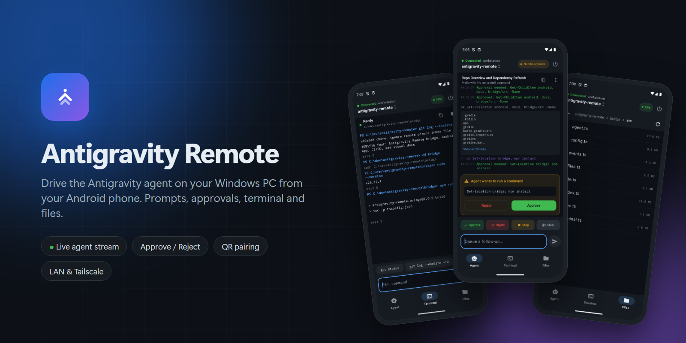
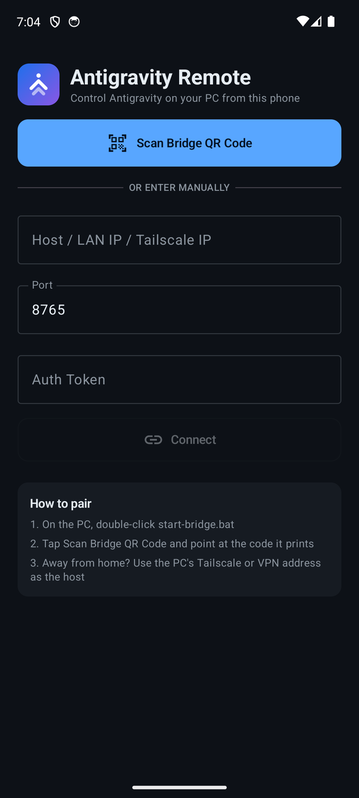
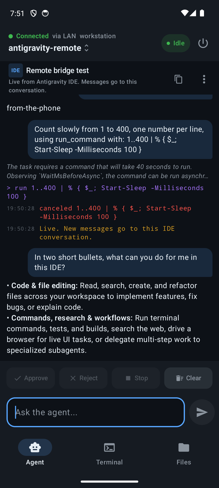
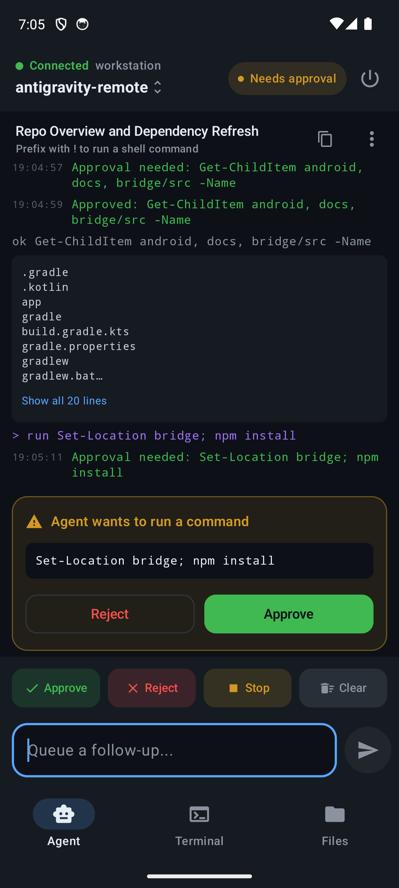

<p align="center">
  
</p>

<p align="center">
  <a href="https://github.com/dor2500/antigravity-remote/releases/latest"></a>
  <a href="https://github.com/dor2500/antigravity-remote/actions/workflows/build-apk.yml"></a>
  
  <a href="LICENSE"></a>
</p>

<p align="center">
  <a href="https://github.com/dor2500/antigravity-remote/releases/latest">
    
  </a>
</p>

<p align="center"><b><a href="README.he.md">עברית</a></b> | English</p>

**Antigravity Remote** puts Antigravity IDE on your Android phone. Follow the IDE's agent conversations live and reply to them, start new ones, approve or reject the commands the agent wants to run, use a terminal in the project folder, and browse the code. It works at home and away, on Wi-Fi or mobile data: you scan a QR code once and the app finds your PC by itself from then on. The app is in Hebrew and English.

## Screenshots

| Pair | IDE conversation | Agent | Terminal | Files |
| :---: | :---: | :---: | :---: | :---: |
|  |  |  |  |  |
| Scan the QR code or enter the address | Follow and reply to IDE conversations | Live output with Approve / Reject | PowerShell in the workspace | Browse and read project files |

## Quick start

1. **Start the bridge on Windows.** Clone this repository and double-click `start-bridge.bat`. It updates itself from GitHub, installs what it needs (Node.js and Cloudflare's `cloudflared`, with winget), opens a secure tunnel so the phone works from anywhere, asks once (UAC) to open port 8765 for your home network, and shows a QR code. Keep its window open.

   ```powershell
   git clone https://github.com/dor2500/antigravity-remote; .\antigravity-remote\start-bridge.bat
   ```

2. **Install the app on Android.** Download [`AntigravityRemote-latest.apk`](https://github.com/dor2500/antigravity-remote/releases/latest/download/AntigravityRemote-latest.apk) on the phone and open it. Allow installs from your browser if Android asks.

3. **Scan the QR code.** Tap **Scan the QR code** and point the camera at the bridge window. That is all: from then on the app connects by itself, at home or away, even after the PC restarts.

App updates are one tap: **Settings > Check for updates** downloads the newest release from GitHub, checks its SHA-256 and opens the Android installer. The PC side updates itself every time `start-bridge.bat` starts.

### Requirements

| On the PC | On the phone |
| --- | --- |
| Windows 10 or 11 | Android 8.0 (API 26) or newer |
| [Antigravity](https://antigravity.google) with its CLI (`agy`) signed in: run `agy` once in a terminal | Any internet connection |
| Node.js 18+ (installed automatically with winget if missing) | |

## How it works

```
 Android app  -- REST + WebSocket (token) -->  Bridge (Node.js, Windows)
   LAN / Tailscale / https tunnel                 |- Antigravity hub .. IDE conversations: follow, reply, stop, approve
                                                  |- agy acp ......... bridge agent session (Agent Client Protocol)
                                                  |- PowerShell ...... terminal tab, runs in the workspace
                                                  |- file system ..... files tab, read-only, sandboxed to the workspace
                                                  '- Antigravity IDE . "Open in IDE" for the active folder
```

### IDE conversations

Antigravity IDE runs its agent in a local hub process (`agy --hub`). The bridge finds the running hub and talks to it on localhost, so the phone sees the same conversations as the IDE. Open the **Agent** tab menu, choose **IDE conversations**, and pick one: its history loads, new steps stream in live, and what you type is sent into that conversation, exactly as if you typed it in the IDE. You can also start a new IDE conversation from the same sheet. **Stop** cancels the running turn, and **Leave IDE conversation** returns to the bridge's own agent session.

The hub interface is internal to Antigravity and not documented. It was mapped against Antigravity 1.5.14 (hub 2.34.0), so a future Antigravity update may change it. When the IDE asks for approval (only if your IDE settings do not auto-run commands), the request appears on the phone as an approval card. That path follows the protocol definitions but could not be exercised on the development PC, because its IDE auto-approves everything.

### Bridge agent session

When no IDE conversation is open, the bridge starts the Antigravity agent through its **Agent Client Protocol** server (`agy acp`) in the active workspace. Everything the agent does streams to the phone: replies, thinking, tool calls and command output. When the agent asks permission to run a command or edit a file, the request appears on the phone as an approval card. **Approve** and **Reject** answer that request directly, **Stop** cancels the current turn, and **New session** in the menu starts a fresh conversation.

### Features

- **Agent tab**: multi-line prompt box, live markdown output, approval cards, a queue for follow-up prompts, copy-all and long-press-to-copy. Prefix a prompt with `!` to run it as a shell command instead.
- **Quick actions**: `Approve`, `Reject`, `Stop` and `Clear`, enabled only when they apply.
- **Terminal tab**: PowerShell in the workspace. `cd` persists between commands, text typed while a command runs goes to its stdin (answer `y/n` prompts, `Read-Host`, and so on), and there are one-tap chips for common git and npm commands.
- **Files tab**: breadcrumb navigation and a line-numbered viewer with copy. Reading is limited to the active workspace, and files over 256 KB are truncated.
- **Workspaces**: switch the project folder from the phone. The list is filled from Antigravity IDE's recent folders and common project roots, and you can type any path. **Open in IDE** opens the folder in Antigravity IDE on the PC.
- **Connection**: QR pairing, manual entry, a saved profile with every route to the PC, automatic failover between routes, reconnect with backoff, and an immediate reconnect when the network changes or the app returns to the foreground. The status bar shows whether you are connected via LAN, Tailscale or Internet.

## Use it from anywhere

Nothing to set up. `start-bridge.bat` opens a free Cloudflare quick tunnel (an `https://...trycloudflare.com` address) next to the home-network address, and the QR code carries both. The phone tries the fastest route first and switches by itself, for example from Wi-Fi at home to mobile data on the road.

**After a restart.** A quick tunnel gets a new address every time the bridge starts. You do not scan again: the bridge publishes its current addresses to a relay (a private topic on the free [ntfy.sh](https://ntfy.sh) service), encrypted with AES-256-GCM using a key derived from your pairing token. When the saved addresses stop answering, the app reads the relay, decrypts the new addresses and reconnects. The topic name is also derived from the token, so only your phone can find it, and ntfy.sh only ever sees ciphertext. To turn this off, set `"relay": false` in the config file or pass `--no-relay` to the bridge, in which case scan again after each restart.

### Do I need Tailscale?

No. The tunnel and the relay cover access from anywhere. Tailscale is an optional extra: install it on the PC and on the phone with the same account, restart the bridge and scan once, and the app also gets a private, fixed route that never leaves your Tailscale network. The firewall rule already allows Tailscale's address range.

**Your own stable URL.** If you run a tunnel or reverse proxy with a fixed `https://` address that forwards to `http://localhost:8765` (a named Cloudflare Tunnel, an ngrok static domain), put it in the config file as `publicUrl`, or pass `start-bridge.bat -PublicUrl https://your-address`. It is added to the QR code as a route and does not change between restarts.

With any tunnel, anyone who finds the URL reaches the bridge's token check, so the bridge locks out an address for 10 minutes after 10 wrong tokens.

## Bridge reference

`start-bridge.ps1` accepts these options (`start-bridge.bat` passes them through):

| Option | Purpose |
| --- | --- |
| `-Port 8765` | Port to listen on |
| `-Workspace C:\path\to\project` | Folder to open first |
| `-Name "Office PC"` | PC name shown in the app |
| `-ResetToken` | Issue a new token, which unpairs every phone |
| `-NoTunnel` | Home network and Tailscale only, no Cloudflare tunnel |
| `-NoUpdate` | Do not update from GitHub at start |
| `-PublicUrl https://...` | Your own public https address that forwards to the bridge (added to the QR code) |
| `-SkipFirewall` | Do not create the firewall rule |

Settings and the token are stored in `%APPDATA%\antigravity-remote\bridge-config.json`. You can also set `agentCommand` (path to `agy.exe`), `ideCli`, `shell` (for example `pwsh.exe`) and `advertiseHost` (the address put in the QR code, such as your Tailscale IP) there.

<details>
<summary>HTTP and WebSocket API</summary>

Every `/api` call needs `Authorization: Bearer <token>`. The WebSocket takes the token as `?token=`.

| Method | Path | Body | Purpose |
| --- | --- | --- | --- |
| GET | `/health` | | Liveness check (no token) |
| GET | `/api/status` | | PC, workspace, agent, terminal and IDE state |
| GET | `/api/workspaces` | | Known workspaces |
| POST | `/api/workspaces/switch` | `{ "path" }` | Change the active workspace |
| POST | `/api/prompt` | `{ "prompt" }` | Send to the agent (`!cmd` runs in the terminal) |
| POST | `/api/action` | `{ "action", "target" }` | `approve`, `reject`, `stop`, `restart`, `retry`, `clear`. `target` is `agent` or `terminal` |
| POST | `/api/terminal` | `{ "command" }` | Run a command |
| POST | `/api/terminal/input` | `{ "text" }` | Write a line to the running command's stdin |
| GET | `/api/files?path=` | | List a folder |
| GET | `/api/files/read?path=` | | Read a file |
| POST | `/api/ide/open` | `{ "path"? }` | Open a folder in Antigravity IDE |
| GET | `/api/ide/conversations` | | Antigravity IDE conversations, newest first |
| POST | `/api/ide/conversations/open` | `{ "id" }` | Follow an IDE conversation; prompts and actions go to it |
| POST | `/api/ide/conversations/new` | `{ "prompt" }` | Start a new IDE conversation and follow it |
| POST | `/api/ide/conversations/close` | | Return to the bridge agent session |
| WS | `/ws?token=` | | Event stream: `log`, `status`, `clear`, `permission`, `permission_resolved` |

</details>

## Security

The token gives full control of the agent and a shell on your PC, so treat it like a password.

- The bridge only answers requests that carry the 48-character token (compared in constant time), and locks out an address for 10 minutes after 10 wrong tokens.
- The firewall rule allows the port from the local subnet and Tailscale (`100.64.0.0/10`) only. Do not forward the port on your router; use Tailscale, or a tunnel that gives you `https`.
- Traffic is plain HTTP on your LAN, encrypted end to end over Tailscale, and HTTPS through a tunnel URL.
- The bridge reaches Antigravity's hub on localhost with the CSRF token the hub writes for local clients; nothing from the hub is exposed beyond what the phone's token already allows.
- The address relay sends only AES-256-GCM ciphertext to ntfy.sh, under a topic name derived from the token. Turn it off with `"relay": false` in the config file.
- Run `start-bridge.bat -ResetToken` to revoke every paired phone.

## Building from source

```powershell
.\build-apk.ps1            # builds dist\AntigravityRemote-latest.apk
.\build-apk.ps1 -Install   # also installs it on a connected device with adb
```

The script finds JDK 17 and the Android SDK on its own. Release signing reads `android/keystore.properties` (`storeFile`, `storePassword`, `keyAlias`, `keyPassword`) or the `ANDROID_KEYSTORE_PATH`, `ANDROID_KEYSTORE_PASSWORD`, `ANDROID_KEY_ALIAS` and `ANDROID_KEY_PASSWORD` environment variables. Without either, it signs with the debug key, so the APK still installs.

The bridge on its own:

```powershell
cd bridge
npm ci
npm run build
node dist/index.js --port 8765
```

### Continuous integration

[`.github/workflows/build-apk.yml`](.github/workflows/build-apk.yml) type-checks the bridge, builds and signs the APK, and publishes it:

- a pushed `v*` tag creates a versioned release marked **Latest** with `AntigravityRemote-latest.apk`;
- every push to `main` refreshes the **Development build** pre-release.

Store the release key in the repository secrets `ANDROID_KEYSTORE_BASE64`, `ANDROID_KEYSTORE_PASSWORD`, `ANDROID_KEY_ALIAS` and `ANDROID_KEY_PASSWORD` so that every build installs over the previous one.

## Troubleshooting

| Symptom | Fix |
| --- | --- |
| The app cannot reach the PC | Make sure the `start-bridge.bat` window is open on the PC. If its banner says `Away access  home network only`, the tunnel did not start: check the PC's internet connection and run it again. |
| Works away but not at home | Run `start-bridge.bat` again and accept the UAC prompt so it can open the port for your home network. Guest Wi-Fi networks block device-to-device traffic; the tunnel still works there. |
| QR code shows the wrong home address | Set `advertiseHost` in the config file. |
| "IDE conversations (IDE not running)" | Open Antigravity IDE on the PC. The menu enables itself once the IDE's hub is running. |
| "Antigravity CLI (agy) not found" | Install Antigravity, run `agy` once in a terminal to sign in, then restart the bridge. |
| Agent never starts | Run `agy` in a terminal on the PC and check that it works there. Its sign-in is shared with the bridge. |
| App installed from the old release will not update | Uninstall it once; releases are now signed with a permanent key. |

## License

[MIT](LICENSE)
